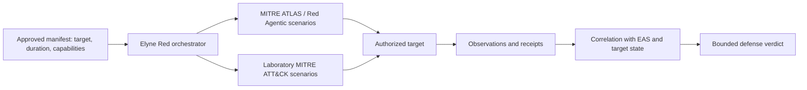

# Elyne Red Unified — public architecture

**English · [Français](architecture.md)**

Elyne Red Unified is an adversarial exercise platform for authorized laboratories. **Red Agentic** is its specialty for AI-agent interfaces and workflows within the same product. Red is supplied with EAS Defense, but a Red technical outcome and an EAS defense verdict are different measurements.

Red actions are real actions on the authorized target. Scope controls, stop conditions, and restoration are therefore operational requirements. A successful Red command, including a zero exit status, is not a defense PASS: the effect must be observed and correlated with target-side traces.

The public documentation contains no attack procedures, payloads, or executable manifests. See [evidence and limits](evidence.en.md).
