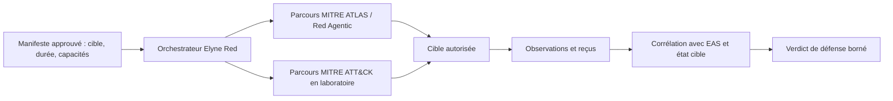

# Elyne Red Unifiée — architecture publique

**Français · [English](architecture.en.md)**

Elyne Red Unifiée est une plateforme d'exercices adversariaux destinée aux laboratoires autorisés. **Red Agentic** désigne sa spécialité visant les interfaces et flux d'agents IA ; elle reste dans le même produit. Red est fournie avec EAS Défense, mais son résultat technique et le verdict de défense EAS sont deux mesures différentes.

Les actions Red sont de véritables actions sur la cible autorisée. Le manifeste, les contrôles de périmètre, l'arrêt et la restauration sont donc des conditions d'exploitation. La réussite d'une commande Red, y compris un code de sortie nul, n'est pas un PASS de la défense : il faut une observation de l'effet et une corrélation avec les traces de la cible.

La documentation publique n'inclut pas de procédures d'attaque, de charges utiles ou de manifestes exécutables. Voir [preuves et limites](evidence.md).
